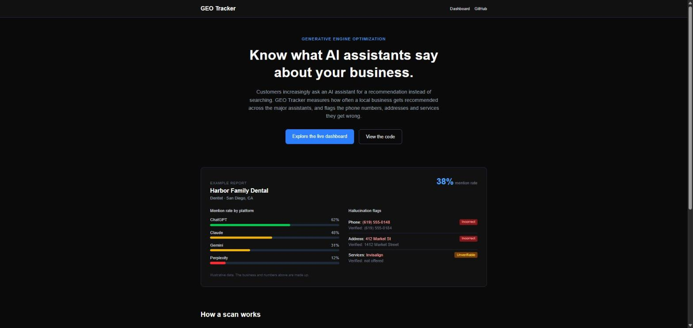

# GEO Tracker

[](https://github.com/Qwakkins/AI-SEO/actions/workflows/ci.yml)

**Live:** https://geo-tracker-seven-zeta.vercel.app

Customers increasingly ask ChatGPT or Perplexity "who's the best dentist near me?" instead of searching. GEO Tracker (generative engine optimization) measures how often a local business is recommended by the major AI assistants, who gets recommended instead, and which facts the assistants get wrong about it.



## What it does

- **Visibility scans.** Each business has a set of search prompts. A scan sends every prompt to ChatGPT, Claude, Gemini and Perplexity, then records whether the business was named, where it appeared in the answer, and which competitors were listed.
- **Hallucination detection.** Phone numbers, street addresses, websites and services are extracted from each answer and compared against the owner's verified details. Mismatches are flagged as *incorrect*, *unverifiable* or *not mentioned*, with a confidence score.
- **Trends.** Results roll up into one mention rate per platform per day, charted over time. A weekly Vercel Cron job rescans every business.
- **Read-only public demo.** The live site lets anyone browse the dashboard and reports. Adding businesses, editing facts and running scans (which spend AI API credits) are disabled unless `NEXT_PUBLIC_ALLOW_WRITES=true`, and every write route checks that flag server-side.

## How it works

```
prompts ──► platforms/{chatgpt,claude,gemini,perplexity}.ts
               │  raw answers
               ▼
          analyzer.ts ──────────────► query_results
          (mention, position,
           competitors)
               │
               ├──► aggregator.ts ──► visibility_scores (upsert per platform/day)
               │
               └──► fact-extractor.ts ─► hallucination-detector.ts ─► hallucination_flags
                    (phones, addresses,   (normalize, Levenshtein
                     sites, services)      match vs. ground truth)
```

| Area | Where |
| --- | --- |
| Scanner pipeline | `src/lib/scanner/` |
| API routes (scan, results, ground truth, flags, cron) | `src/app/api/` |
| Dashboard and business detail pages | `src/app/dashboard`, `src/app/business/[id]` |
| Read-only guard | `src/lib/access.ts` |
| Database schema (Postgres migrations) | `supabase/` |
| Unit tests | `src/lib/scanner/__tests__/` |

Some design choices:

- **Conservative extraction.** The fact extractor prefers missing a claim to inventing one, so a flag means something.
- **Fuzzy address matching.** Addresses are normalized ("St" → "street") and compared by edit distance, so small typos aren't reported as hallucinations but a different street is.
- **Idempotent scoring.** A unique constraint on `(business_id, platform, period_start, period_end)` lets a same-day rescan upsert rather than duplicate.
- **Pay for what you use.** A platform is scanned only when its API key is configured.

## Stack

Next.js 16 (App Router) · React 19 · TypeScript · Supabase (Postgres) · OpenAI, Anthropic, Gemini and Perplexity APIs · Recharts · Tailwind CSS 4 · Vitest · Vercel (hosting and cron)

## Run it locally

Requires Node 24+, a Supabase project and at least one AI platform key.

```bash
git clone https://github.com/Qwakkins/AI-SEO.git
cd AI-SEO
npm install
cp .env.example .env.local   # fill in the values; set NEXT_PUBLIC_ALLOW_WRITES=true
```

Run the SQL files in `supabase/` in order (`001` to `006`) in the Supabase SQL editor, then:

```bash
npm run dev        # http://localhost:3000
npm test           # unit tests
npm run lint
npm run typecheck
```

## License

MIT
